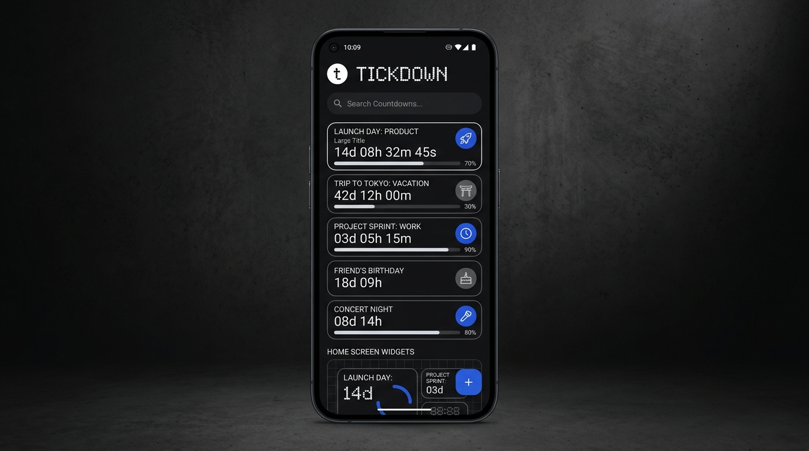

<div align="center">

# ⏳ Tickdown

**A minimal, industrial-aesthetic countdown & reminder app with Glance home screen widgets for Android.**

[](https://developer.android.com)
[](https://kotlinlang.org)
[](https://developer.android.com/jetpack/compose)
[](https://developer.android.com/jetpack/compose/glance)
[](LICENSE)

<br/>



</div>

---

## 💡 Problem Statement

In today's fast-paced environment, keeping track of essential deadlines, flight departures, project launches, exams, subscription renewals, and personal milestones is critical. However, most existing countdown and reminder solutions suffer from common pitfalls:

- **Cluttered & Bloated Interfaces:** Overloaded with unnecessary social features, aggressive ads, upsells, and confusing navigation that detract from rapid glanceability.
- **Unreliable & Stale Home Screen Widgets:** Standard Android widgets frequently freeze, fail to refresh across system reboots or timezone changes, or drain excessive battery with unoptimized background polling.
- **Inflexible Recurrence & Rollover:** Lack of seamless recurring countdowns (daily, weekly, monthly, annual) that automatically roll over to the next milestone once a deadline passes.
- **Lack of Cohesive Aesthetic:** Few apps offer a deliberate, distraction-free aesthetic matching modern monochrome hardware and design sensibilities (like Nothing OS and Scandinavian industrial minimalism).

**Tickdown** resolves these pain points with a **purpose-built, local-first countdown engine** paired with **Jetpack Glance widgets** engineered for zero fluff, precision timing, and refined typography.

---

## ✨ Features

- **🖤 Refined Industrial Aesthetics:** Monochromatic dark/light palette inspired by dot-matrix displays, crisp typographic contrast, and subtle cobalt blue accent badges.
- **📱 Jetpack Glance Home Screen Widgets:** Battery-efficient, reactive widgets that deliver real-time countdown progress directly on your Android home screen without waking up unnecessary background services.
- **🔄 Intelligent Recurrence & Rollover:** Flexible recurring schedules (One-time, Daily, Weekly, Monthly, Yearly) with automatic next-occurrence rollover.
- **⏰ Multi-Layered Alarm Pipeline:** Built on Android `AlarmManager` and `WorkManager` reconciliation workers to ensure exact-alarm triggers survive device reboots, time drift, and timezone transitions.
- **🎯 Interactive Widget Configuration:** Choose which event to showcase, customize display formats, and inspect remaining time down to seconds, minutes, or days.
- **🔒 100% Offline & Private:** Powered locally by Android Room database. No account creation, no analytics tracking, no ads, and no external cloud dependency.

---

## 🛠️ Tech Stack & Architecture

Tickdown is built using modern Android development practices and the Google Jetpack library suite:

| Layer | Technologies |
|---|---|
| **Language** | Kotlin 2.0 |
| **UI Toolkit** | Jetpack Compose (Material 3) |
| **Widgets** | Jetpack Glance AppWidget + Android RemoteViews |
| **Local Storage** | Room Database (SQLite) + Jetpack DataStore |
| **Concurrency** | Kotlin Coroutines & Asynchronous Flow |
| **Background Scheduling** | Android `AlarmManager` (`SCHEDULE_EXACT_ALARM`) + AndroidX `WorkManager` |
| **Architecture** | Clean Architecture / MVI-inspired UI state pattern |

---

## 📂 Project Structure

```text
com.example.tickdown/
├── data/
│   ├── local/            # Room Database, entities, and DAOs
│   ├── preferences/      # DataStore preferences & widget config repo
│   └── repository/       # Implementation of CountdownRepository
├── domain/
│   ├── model/            # CountdownEvent, RecurrenceRule, EventStatus
│   ├── recurrence/       # Recurrence engine & occurrence calculations
│   └── repository/       # CountdownRepository abstraction
├── system/
│   ├── scheduler/        # AlarmManager receivers & WorkManager reconciliation
│   └── sample/           # Debug seed data
├── theme/                # Monochromatic palette, Typography, & Theme definition
├── ui/
│   ├── components/       # Reusable design system (cards, badges, buttons)
│   ├── home/             # Main dashboard & active countdown list
│   ├── create/           # Event creation & editing workflow
│   ├── detail/           # Event detail & countdown breakdown
│   └── settings/         # App settings & preferences
└── widget/               # Jetpack Glance widgets, receivers, & config activity
```

---

## 🚀 Getting Started

### Prerequisites

- **Android Studio Ladybug (2024.2+)** or newer
- **JDK 17** or **JDK 21**
- **Android SDK:**
  - `compileSdk`: 35
  - `minSdk`: 26 (Android 8.0 Oreo)
  - `targetSdk`: 35 (Android 15)

### Build & Run

1. Clone the repository:
   ```bash
   git clone https://github.com/1ambharath/Tickdown.git
   cd Tickdown
   ```

2. Open the project in **Android Studio**.

3. Build and run on an emulator or physical device:
   ```bash
   ./gradlew installDebug
   ```

---

## 📄 License

This project is licensed under the **Apache License 2.0**. See the [LICENSE](LICENSE) file for details.

---

<div align="center">
Crafted with precision by <b><a href="https://github.com/1ambharath">@1ambharath</a></b>
</div>
